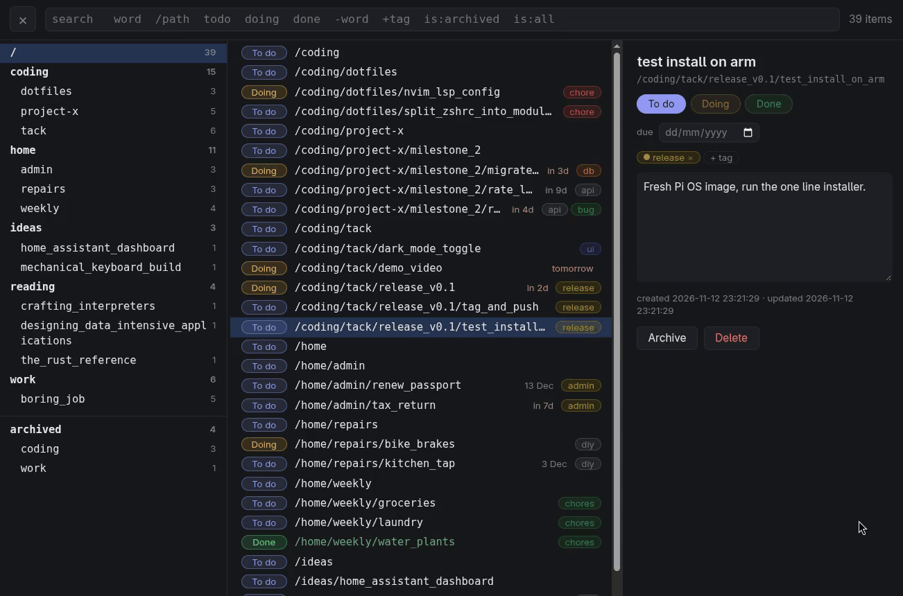

# tack

Todo tree for the terminal, the browser and coding agents.



```console
$ tack add work/boring_job/fix login
todo  /work/boring_job/fix_login

$ tack ls /work
todo  /work
todo  /work/boring_job
todo  /work/boring_job/fix_login
```

- **paths, not lists:** Items are addressed like paths, `add` creates parents like `mkdir -p`
- **fast:** A `HashMap` holds the nodes, with paths and order precomputed on write. DB only sees writes
- **no setup:** Two static binaries, no runtime, no accounts. State is one SQLite file
- **three ways in:** webui, CLI and MCP, one query language
- **small:** The webui is one 33 KB HTML file, no framework, no build step

## Install

Linux, x86_64, aarch64 and armv6

**Server** `tackd` systemd service on port 15470:

```sh
curl -fsSL https://raw.githubusercontent.com/ueco-jb/tack/master/install.sh | sh -s -- --server
```

**Client** `tack`:

```sh
curl -fsSL https://raw.githubusercontent.com/ueco-jb/tack/master/install.sh | sh
```

## Server

```
tackd [--addr 0.0.0.0:15470] [--db <file>] [--log <file>] [--allow-host <name>]
```

- **database:** `~/.local/share/tack/tack.db`
- **request log:** `~/.local/state/tack/requests.log`, one JSON line per change
- **service:** `systemctl status tackd`, `journalctl -u tackd`
- **allowed hosts:** IP, `localhost`, `$HOSTNAME`, `$HOSTNAME.local`, extend with `--allow-host`

| Command | Does |
|---|---|
| `tackd allow` | list allowed IPs, empty allows everyone |
| `tackd allow <ip>` | add an IP, unlisted clients get 403 |
| `tackd deny <ip>` | remove an IP |

## Terminal

First run saves the server to `~/.config/tack/server`:

```console
$ tack ls
tack server [http://localhost:15470]: myhost
```

| Command | Does |
|---|---|
| `tack server [url]` | show or set the server |
| `tack ls [query]` | list matching items |
| `tack show <item>` | one item with its body |
| `tack add <path>` | add, flags `-b` body, `-t` tag, `-d` due date, `-s` status |
| `tack done <item>` | mark done, `-f` with open children |
| `tack mv <item> <path>` | move or rename |
| `tack set <item>` | change status, body, tags, due date, archive |
| `tack rm <item>` | delete, `-r` with children |
| `--url <url>` | server for one call |

`<item>` is a path or a numeric id

## Search

| Query | Matches |
|---|---|
| `milestone` | paths containing the word |
| `/coding/project-x` | the path and everything under it |
| `-release` | paths without the word |
| `+bug`, `tag:bug` | items tagged `bug` |
| `todo`, `doing`, `done` | items with that status |
| `is:open`, `is:done` | open or done items |
| `is:archived`, `is:all` | archived items, or everything |
| `/coding +bug todo` | all terms at once |

## Agents

MCP over HTTP at `/mcp`, tools `search`, `get`, `add`, `update`, `delete`, `labels`

**omp** `~/.omp/agent/mcp.json`:

```json
{
  "mcpServers": {
    "tack": { "type": "http", "url": "http://myhost:15470/mcp" }
  }
}
```

**Claude Code**:

```sh
claude mcp add --scope user --transport http tack http://myhost:15470/mcp
```

Ask in plain words:

```console
> add the login redirect bug to tack
todo   /work/boring_job/fix_login_redirect  +bug

> what's still open in project-x?
todo   /coding/project-x/milestone_2/rate_limit_login     +api
doing  /coding/project-x/milestone_2/migrate_users_table  +db

> users table is migrated, close it and the milestone if nothing else is left
done   /coding/project-x/milestone_2/migrate_users_table  +db
todo   /coding/project-x/milestone_2: rate_limit_login is still open
```

## Uninstall

**Server**:

```sh
sudo systemctl disable --now tackd
sudo rm /etc/systemd/system/tackd.service
rm ~/.local/bin/tackd
```

**Data**:

```sh
rm -r ~/.local/share/tack ~/.local/state/tack
```

**Client**:

```sh
rm ~/.local/bin/tack
rm -r ~/.config/tack
```
